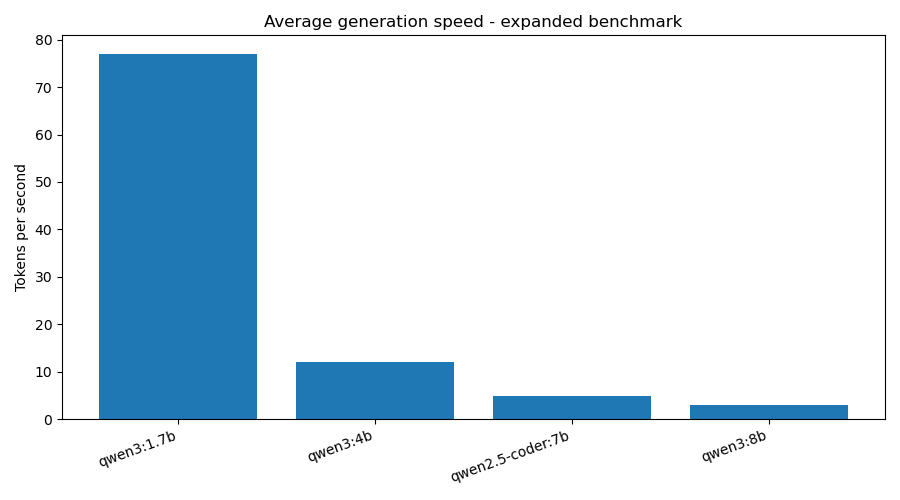
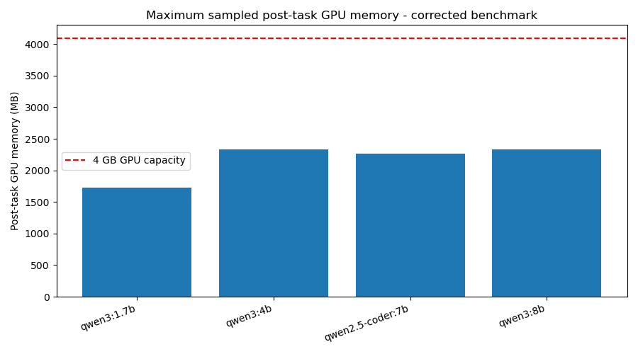

# TinyToolBench

A small benchmark for comparing local language models on tool-calling tasks through [Ollama](https://ollama.com). It checks whether a model picks the right tool, supplies correct arguments, handles multi-step tasks, and avoids calling a tool when none is needed. It also records generation speed and GPU-memory samples on one 4 GB laptop GPU.

TinyToolBench is a hand-written, fixed benchmark run on one machine. It is useful for exploring behavior on these tasks, not for ranking models generally. The corrected v4 run is complete (360 attempts: 30 tasks x 3 runs x 4 models).

Historical v3 results and migration notes: [docs/HISTORY.md](docs/HISTORY.md).

## V4 setup

| Item | Value |
|---|---|
| GPU / VRAM | NVIDIA RTX 2050, 4 GB |
| System RAM | 8 GB |
| OS | Windows 11, PowerShell |
| Run dates | 2026-10-19 and 2026-10-20 (two resumed sessions) |
| Ollama CLI version | `0.40.3` |
| Python Ollama client | `0.6.3` |
| Python | `3.14.3` |
| Temperature | 0 |
| Qwen3 thinking | Off (`think=False` for Qwen3 models) |
| Runs per task | 3 |

The runner writes metadata JSON sidecars with the command, runtime versions, task/tool hashes, model family/size/quantization, benchmark settings, and GPU-memory baseline when available.

### Model quantization

| Model | Quantization |
|---|---|
| `qwen3:1.7b` | Q4_K_M |
| `qwen3:4b` | Q4_K_M |
| `qwen3:8b` | Q4_K_M |
| `qwen2.5-coder:7b` | Q4_K_M |

These values were recorded from the models loaded during v4.

## Tasks

There are 30 hand-written tasks in `tasks.json`, run 3 times per model (90 attempts per model). Every task offers the same four fixed-data tools, with no internet access: `add`, `multiply`, `get_price`, and `search_notes`. All four tools are offered each time, so the model must select among distractors.

| Category | Tasks | What it tests |
|---|---:|---|
| Single | 6 | One tool call |
| Selection | 5 | Choose the right tool for the request |
| Chain | 9 | Multiple dependent tool calls in the required order |
| No-tool | 6 | Answer directly without calling a tool |
| Robustness | 4 | Requests that test tool limits |

## Scoring

Scoring is automatic; there is no LLM judge. A run passes only when the model makes exactly the expected calls with the expected arguments. Argument order for `add` and `multiply` does not matter. Calls are order-independent unless a task explicitly has `"ordered": true`; dependent chain tasks use that setting.

If a task defines an `expected_answer`, the final answer must contain the expected number as a whole number token, or the expected text as a case- and punctuation-normalized sequence of words. This is stricter than a substring check but is not semantic evaluation. No-tool tasks must return a non-empty answer; tasks with a gold answer must also match it. A task passes when at least 2 of its 3 attempts pass. The reported 95% Wilson interval is calculated over tasks, not individual attempts.

The task validator checks IDs, categories, prompts, expected calls, tool names, argument names, and argument types before inference begins.

## Corrected v4 results

Each task passes when at least 2 of its 3 runs pass. These are the task-level results under the corrected checker.

| Model | Tasks passed | Pass rate | 95% Wilson interval | Avg tokens/s | Max sampled post-task GPU memory |
|---|---:|---:|---:|---:|---:|
| `qwen3:8b` | 20/30 | 66.7% | 48.8-80.8% | 2.9 | 2335 MB |
| `qwen3:4b` | 17/30 | 56.7% | 39.2-72.6% | 12.1 | 2337 MB |
| `qwen3:1.7b` | 11/30 | 36.7% | 21.9-54.5% | 77.1 | 1727 MB |
| `qwen2.5-coder:7b` | 2/30 | 6.7% | 1.8-21.3% | 5.0 | 2265 MB |

### Findings

- **Chains are the clearest weakness:** the 1.7B and coder models had 0/27 passing chain attempts; the 4B had 6/27 and the 8B had 15/27.
- **The 8B's lead over the 4B is not conclusive:** 20 vs. 17 tasks passed, with overlapping Wilson intervals and 25 ties in the paired task comparison.
- **The coder score needs a caveat:** it wrote tool-call-shaped text instead of structured calls in 84/90 runs, so its 2/30 result mainly reflects compatibility with Ollama's structured tool-call interface, not general tool-use ability.





### V4 by category (individual runs)

| Model | Chain (27) | No-tool (18) | Robustness (12) | Selection (15) | Single (18) |
|---|---:|---:|---:|---:|---:|
| `qwen3:8b` | 15/27 | 12/18 | 9/12 | 9/15 | 15/18 |
| `qwen3:4b` | 6/27 | 12/18 | 8/12 | 10/15 | 15/18 |
| `qwen3:1.7b` | 0/27 | 12/18 | 4/12 | 9/15 | 8/18 |
| `qwen2.5-coder:7b` | 0/27 | 6/18 | 0/12 | 0/15 | 0/18 |

The CSV has 360 unique model/task/run records, all with `status=ok`. The full answers are retained in `results/results_v4.csv`; the run metadata sidecars record two resumed sessions with matching task and tool hashes. The completed run produced `results/performance_summary_v4.csv`, `results/results_v4_with_reasons.csv`, `results/failure_breakdown_v4.csv`, `results/speed_v4.png`, and `results/post_task_vram_v4.png`.

## Measurement notes

GPU memory is sampled after each task with `nvidia-smi`. The v4 charts and summary report the maximum raw post-task sample; this is **not** continuous peak VRAM monitoring and can miss higher usage during inference. The completed v4 data spans two resumed sessions with different idle readings, so raw post-task memory is shown instead of subtracting one baseline from all rows. CPU/GPU placement is a runtime snapshot, not a per-task measurement.

## Limitations

- Only 30 tasks, written by one person; small differences are uncertain.
- All tasks run at temperature 0, so repeated attempts may be very similar and are not independent evidence.
- Results depend on one machine, GPU, runtime, model tags, and tool schemas.
- Quantization is not experimentally isolated; model families, sizes, and tags differ.
- The answer checker is deterministic and more exact than substring matching, but it cannot judge meaning or paraphrases.
- Fake tools are simpler than real tools with network failures, changing data, permissions, or side effects.
- Historical v3 scores used older scoring rules and should not be treated as corrected results.

## Related work

- [Berkeley Function Calling Leaderboard (BFCL)](https://gorilla.cs.berkeley.edu/leaderboard.html) evaluates function calling with a much broader set of tasks and settings. TinyToolBench is a small fixed local suite.
- [BenchLoop](https://github.com/outsourc-e/bench-loop) is a local-first benchmarking project with broader quality, speed, reliability, and multi-turn evaluation capabilities.

TinyToolBench differs in its small fixed set of local tools, deterministic checker without an LLM judge, and focus on speed and memory observations from a constrained laptop.

## Running the benchmark

1. Install [Ollama](https://ollama.com), then pull the models you want to test:
   ```powershell
   ollama pull qwen3:1.7b
   ollama pull qwen3:4b
   ollama pull qwen3:8b
   ollama pull qwen2.5-coder:7b
   ```
2. Use standard Windows CPython 3.11 or newer (not the MSYS Python distribution), create/activate a virtual environment, and install the benchmark dependency. The Ollama client depends on `pydantic-core`, which may try to build from source under MSYS Python:
   ```powershell
   python -m pip install -r requirements.txt
   ```
   To regenerate the charts, install the optional plotting dependency too:
   ```powershell
   python -m pip install -r requirements-visualization.txt
   ```
   Use standard Windows CPython for chart generation; the MSYS Python used for this run may not have a matching Matplotlib wheel and can try to build it from source.
3. Run all models, or pass model tags to run only selected models:
   ```powershell
   python run_benchmark.py
   python run_benchmark.py qwen3:4b
   ```
   The corrected raw attempts append to `results/results_v4.csv`. Each invocation also writes `results/run_metadata_<session>.json`. Existing v3 data is never migrated into v4 because it used different scoring rules.
4. Analyze v4 data:
   Run these commands from the repository root:
   ```powershell
   python scripts/performance_table.py
   python scripts/analyze.py
   python scripts/failures.py
   python scripts/category_table.py
   python scripts/task_comparison.py
   ```
   These create the v4 summary CSVs and charts under `results/`. The chart script requires `requirements-visualization.txt`. Run `python run_benchmark.py` first; the analysis scripts intentionally do not fall back to historical data.

## License

MIT. See [LICENSE](LICENSE).
